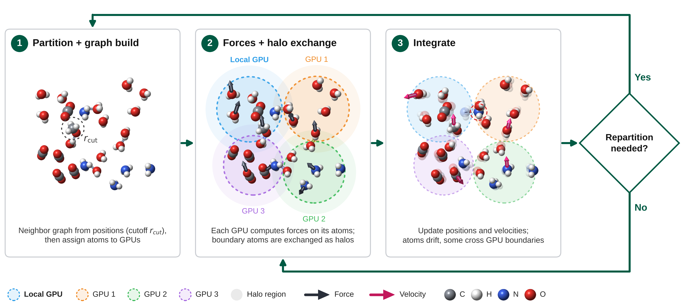

# Dynamis

`Dynamis` is a distributed neural network potential framework designed to efficiently compute forces and energies for large-scale molecular simulations. It is built on top of PyTorch and provides a modular architecture for defining state representations, force computations, and integration algorithms on multi-GPU systems. The framework uses custom CUDA kernels to optimize performance and scalability, making it suitable for simulating complex systems with millions of atoms.


## Motivation

Molecular Dynamics (MD) simulations of million-atom systems are essential for suppressing finite-size artifacts, yet achieving ab initio accuracy at this scale remains intractable. Neural Network Potentials (NNPs) offer Density Functional Theory (DFT) fidelity at lower cost, but scaling them exposes a critical gap: traditional MD engines are not designed for deep-learning workloads, while general distributed deep-learning frameworks fail to support MD's dynamic, sparse communication and strict numerical precision.
Existing simulation ecosystems are ill-equipped for this workload: traditional MD engines are architecturally rigid and not designed for deep learning operations, while general-purpose distributed deep learning frameworks assume dense, static communication schedules and tolerate reduced numerical precision. In contrast, NNP-driven MD relies on Graph Neural Network (GNN) message passing over sparse, time-varying neighbor lists that require continual re-derivation, compounded by the strict precision demands needed to keep dynamical trajectories physically stable.
To address this, we present Dynamis, a purpose-built distributed MD engine tailored for NNP inference. Our framework introduces custom GPU-accelerated kernels for dynamic graph construction, spatial partitioning, halo exchange, and numerical integration, alongside low-latency, GPU-native communication primitives. By evaluating state-of-the-art architectures (Orb~\cite{orbv1, orbv3}, UMA~\cite{uma}, MACE~\cite{mace}) with pre-trained weights, we demonstrate scalable multi-GPU and multi-node DFT-quality simulations at length scales previously restricted to empirical force fields.


## Design Philosophy

The life cycle of an MD calculation can be summarized as an N-step process.



1. **Partition + graph build.** *Initialization* sets up the initial state of the system, including the
   partitioning that determines the location of each atom in the computing grid, and the initial
   temperature and pressure. From a compute perspective, this step builds the neighbor graph from
   atomic positions (within a cutoff radius $r_{cut}$), performs domain decomposition, and assigns
   atoms to processing elements (GPUs).
2. **Forces + halo exchange.** Energy and forces are computed using a potential function on each
   processing element. Atoms near partition boundaries are exchanged as *halo* atoms between
   neighboring GPUs so that forces are correct at partition boundaries. For GNN-based potentials,
   halo embeddings are refreshed at every message-passing layer.
3. **Integrate.** Once nuclear forces are obtained, positions and velocities are updated via
   numerical integration. Atoms drift, and some cross GPU boundaries.

Steps **2** and **3** repeat for the desired number of iterations. After each step, the framework
checks whether repartitioning is required (for example, because atoms have migrated enough to
unbalance the work across GPUs). If so, the loop returns to step **1** to rebuild the graph and
reassign atoms; otherwise it continues directly with step **2**.

**Dynamis** provides composable components that allow us to effectively perform steps 2 and 3:
state and partitioning (`dynamis_state`), distributed force computation with halo exchange
(`dynamis_model`), and numerical integration (`dynamis_integrator`).


## Sub-packages

The dynamis project is organized into several sub-packages, each responsible for a specific aspect of the overall functionality. Below is a brief overview of each sub-package:

- `dynamis_state`: This sub-package contains modules and classes related to the state representation of the system. It defines how the state of the system is represented, including positions, velocities, and other relevant properties related to distribution.
- `dynamis_model`: This sub-package focuses on the computation of forces within the system. It includes modules that calculate forces based on the state representation and other relevant parameters, specifically tailored for distribution-based neural network potentials.
- `dynamis_integrator`: This sub-package is responsible for the integration of the equations of motion. It includes modules that implement various integration algorithms to evolve the state of the system over time, taking into account the forces computed by the `dynamis_model` sub-package.
- `dynamis`: This is the main sub-package that serves as the entry point for users.

## Installation

Requires Python >= 3.12 and a CUDA toolchain (set `CUDA_HOME` or `CUDAToolkit_ROOT` if CUDA is not found automatically). The sub-packages are C++/CUDA extensions that link against PyTorch at build time, so install `torch` first and build without isolation.

With [uv](https://docs.astral.sh/uv/):

```bash
uv venv --python 3.12
source .venv/bin/activate
uv pip install torch pytest scipy scikit-build-core pybind11
uv pip install --no-build-isolation -e ./dynamis_state -e ./dynamis_integrator -e ./dynamis_model -e ./dynamis
```

With plain pip:

```bash
python -m venv .venv && source .venv/bin/activate
pip install torch pytest scipy scikit-build-core pybind11
pip install --no-build-isolation -e ./dynamis_state -e ./dynamis_integrator -e ./dynamis_model -e ./dynamis
```

Optional model backends are extras of `dynamis_model`, e.g. `-e "./dynamis_model[mace]"`. Rerun the install for the affected sub-package after any C++/CUDA change.

Run the tests with `pytest`.

## Samples
The `samples` directory contains example scripts that demonstrate how to use the DistNNP framework for a large-scale molecular simulation.


## Copyright

Copyright (c) 2026 Kenneth Chiu, Huanyi Qin, Shehtab Zaman

This software includes code and intellectual contributions from multiple developers, researchers, and designers. For a complete list of project contributors and their respective roles, please refer to the CONTRIBUTORS file included in the root directory of this repository.
